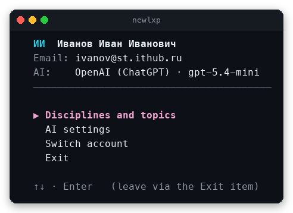
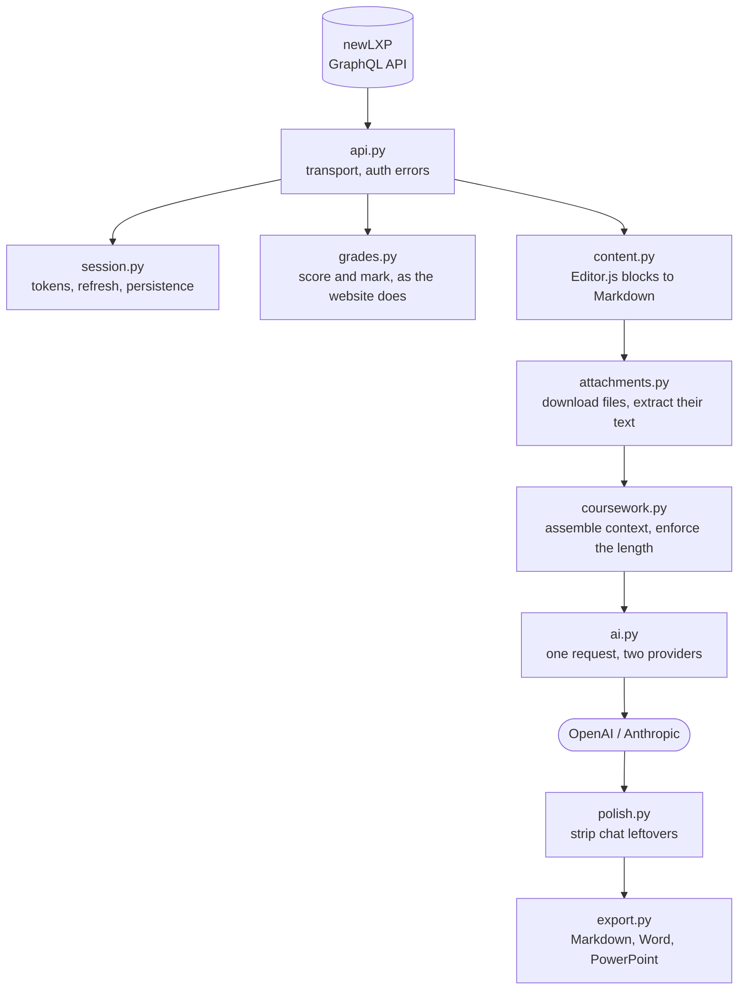
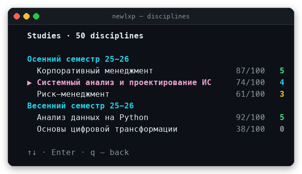

# LLM Quality Pipeline

**A document pipeline that measures what a language model writes, wrapped in a
terminal client for the [newLXP](https://newlxp.ru) learning platform.** Scattered course materials and a task
written in prose go in; a finished, format-compliant document comes out, with
its quality measured rather than eyeballed.


[](LICENSE)


[](https://github.com/AStorozh/llm-quality-pipeline/actions/workflows/ci.yml)

<p align="center">
  
</p>

## Start where you fit

| You are | Go to |
|---|---|
| **A student who just wants to use it** | [Quick start](#quick-start): one command. Then [Navigation](#navigation) and [Configuration](#configuration). |
| **Hiring, or reviewing this as portfolio work** | [What is worth a look](#what-is-worth-a-look): the four parts that are not ordinary client code. |
| **A programmer reading the code** | [How it works](#how-it-works) and [Project layout](#project-layout), then [Development](#development). |

---

## Quick start

You need a newLXP account and Python 3.9 or newer. An AI key is optional:
without one the client still shows your disciplines, grades and the topic
list of every discipline.

The launcher sets everything up on first run and starts the app afterwards.

**macOS / Linux**

```bash
./run.sh
```

**Windows** — double-click `run.bat`, or run it from a terminal.

That is all. The first launch creates a local virtual environment and installs
the optional libraries; later launches are instant, and when
`requirements.txt` changes the launcher reinstalls on its own.

Sign in with your newLXP email and password. Generated works are saved to
`ai_output/` next to the program, one folder per discipline.

<details>
<summary><b>Manual install</b></summary>

```bash
git clone https://github.com/AStorozh/llm-quality-pipeline.git
cd llm-quality-pipeline

python3 -m venv .venv && source .venv/bin/activate
pip install -r requirements.txt          # optional extras, see below
python3 main.py
```

Or install it as a package, which adds a `newlxp` command:

```bash
pip install ".[all]"
newlxp
```

</details>

### Requirements

Python 3.9 or newer. **The client itself needs nothing else** — it runs on the
standard library. Each extra unlocks one capability and is skipped gracefully
when missing:

| Package | Needed for | Extra |
|---|---|---|
| `certifi` | A working CA bundle on macOS, where Python often ships without one | `.[certs]` |
| `python-docx` | Word output, reading `.docx` attachments | `.[docx]` |
| `python-pptx` | PowerPoint output, reading `.pptx` attachments | `.[pptx]` |
| `pypdf` | Reading PDF attachments | `.[pdf]` |

### Navigation

| Key | Action |
|---|---|
| `↑` `↓` | Move between items |
| `Enter` | Open or run the selected item |
| `←` / `Backspace` / `q` / `Esc` | Go back (the main menu is left through its Exit item); `q` also works on a Russian keyboard layout |

---

## What is worth a look

Most of this project is ordinary client code. These four parts are not, and
each exists because something went wrong first:

| | |
|---|---|
| **[A quality gate, not an opinion](#measuring-whether-a-change-helped)** | Sixteen automatic checks score a finished document against its task. `evals/` pins eight cases, six of them defects that kept recurring, and CI fails when one comes back. A live mode regenerates through the model and files the score under the prompt that produced it. |
| **[A judge that was checked first](#judging-what-the-checks-cannot)** | Mechanical checks cannot tell whether reasoning is any good. A rubric can, but only once it has been calibrated against work of known quality, and the calibration is part of the repo. |
| **[Enforcement in code, not in the prompt](#guarantees-in-code-not-in-the-prompt)** | The model kept ignoring a required length and leaving chat text in the output. Asking it more nicely did not work; parsing the requirement out of the task and checking the result did. |
| **[A second look, with a way back](#a-second-look-with-a-way-back)** | For structured tasks the model proposes exact-text fixes to its own work; each one is kept only if it is safe and the checks stay clean. |
| **[Costed and resilient](#paying-for-it-and-surviving-a-rate-limit)** | Token usage is recorded for every run; rate limits are retried with exponential backoff instead of losing the run. |

The quality gate is the part to look at first. It runs with no API key:

```
$ python3 evals/run.py

essay-baseline               100%  A clean essay that covers every topic.
essay-too-short               94%  The model ignores a stated word count.
    FAIL  length                 222 words, the task asks for 1500
structure-missing-appendix    94%  A tighter length budget dropped the appendix.
    FAIL  artifacts              the task asks for an appendix, none found

8 case(s), average score 95%, 0 regression(s)
```

That gate measures the checks themselves. `--live` measures the model instead:
it regenerates the baselines with the client's prompt and output rules,
including the follow-up request when an answer comes back short, and files the
result under the fingerprint of the prompt that produced it. A score with no
prompt attached cannot be compared to anything. Course materials, the second
look and slides are not part of a live run.

```
$ python3 evals/run.py --history

when                 prompt     model            checks  judge
2026-10-10T02:37:23  54c29aad   gpt-5.4-mini       100%    4.4
```

---

## Why it exists

newLXP is a single-page app. Everything it shows — grades, topics, assignment
texts, attached slide decks — arrives over one GraphQL endpoint. This client
talks to that endpoint directly, so the data is available in a terminal, in
plain text, and in a form a script can work with.

Three things turned out to be harder than expected, and most of the
interesting code is there:

1. **Giving a model enough context to be useful.** An assignment makes sense
   only after the topics before it, and those topics carry PDF, Word and
   PowerPoint attachments whose text has to be pulled out first.
2. **Getting the model to obey the assignment.** Tasks state a length, demand
   an appendix, name a method to use. The model agreed to all of it and then
   did as it pleased, which is why those requirements ended up enforced in
   code and checked afterwards.
3. **Reproducing the grade the website shows.** The score and the mark are not
   single fields; they are chosen from six, in an order that depends on whether
   a retake happened and whether the study period has ended.

---

## Features

**Platform**

- **Persistent login.** Authenticate once; the access token is cached in
  `~/.newlxp_session.json` (owner-only) and refreshed before it expires.
- **Grades that match the website.** All disciplines across every study period,
  grouped by semester, with the score and mark derived the same way the
  frontend derives them, retakes included.
- **Topics and checkpoints.** The chapters, study topics and checkpoints of
  each discipline. Topic bodies (Editor.js blocks) are rendered to Markdown and
  fed to the model as context; a checkpoint opens its generation screen.

**Drafting**

- **Bring your own key.** OpenAI or Anthropic, your account, your spend. The
  project ships no model access of its own.
- **Real context.** For a checkpoint the model receives every preceding topic
  and checkpoint in order, including the text extracted from attached PDF,
  `.docx`, `.pptx` and plain-text files, and then the assignment itself.
- **The assignment wins.** A length stated in the task (an essay "of
  1500–2000 words", written in Russian) is parsed out of the text and enforced — if the answer comes
  back short, the client asks for an expansion rather than handing you a work
  that loses marks.
- **Clean output.** Chat leftovers ("If you like, I can format this…"), duplicated
  signatures and self-introductions are stripped before anything is saved.
- **Measured, not eyeballed.** Sixteen automatic checks score a finished work
  against the task: length, required sections, appendices, named methods, and
  the defects that kept recurring. `evals/` pins them as regression cases, so
  "did that prompt change help?" is one command and a number.
- **Costed and resilient.** Every run records its token usage, with the
  money shown where a price is configured. Rate limits and server errors are
  retried with exponential backoff instead of losing the run.

**Output**

- **Word** — Times New Roman 12, no template styles or colours, headings set
  off by two blank lines above and one below.
- **PowerPoint** — 16:9, a title slide, then one slide per section with
  balanced bullet pages.
- **Markdown** — the raw text, for diffing or further processing.
- Files are named after the checkpoint number, the discipline and the author's initials (for example `CP5_Discipline_A.B.C.docx`) and signed at the top with the
  discipline, the checkpoint and the author.

---

## How it works



### Talking to the platform

[`api.py`](newlxp/api.py) keeps every network concern in one place: the SSL
context, the GraphQL documents, and the translation of transport and server
failures into two domain exceptions — `AuthError` and `ApiError`. Everything
above it handles those two and nothing else.

Authentication failures are recognised both from the HTTP status and from the
GraphQL `extensions.code`, with a fallback to keywords in the server's own
Russian messages. [`session.py`](newlxp/session.py) decodes the JWT's `exp`
claim and refreshes the token a minute before it expires; when it cannot, it
raises rather than returning a stale token, so the user is told to sign in
again instead of meeting a confusing error three screens later.

### Reproducing the grade

<p align="center">
  
</p>

[`grades.py`](newlxp/grades.py) is small but it is the part that had to be
reverse-engineered from the frontend. The numerator depends on whether a
retake exists (`scoreForAttempt` → `retakeScore` → `scoreForAnsweredRetakeTasks`,
otherwise `scoreForAnsweredTasks`), and the mark comes from one of three
different fields depending on which scores are present. A mark is only final
once the study period is `FINISHED`; for an ongoing period the site shows
nothing, and so does this client.

### Building the context

Topic bodies are Editor.js block JSON. [`content.py`](newlxp/content.py)
renders headers, paragraphs, lists, tables and images to Markdown, falls back
to the raw block data for unknown types so nothing is silently lost, and
reports the files attached to a topic.

[`attachments.py`](newlxp/attachments.py) downloads those files and extracts
their text, caching the result by URL so a file is fetched once. On a real
course this matters: a single discipline can carry many attachments.

[`coursework.py`](newlxp/coursework.py) assembles the prompt: every preceding
topic and checkpoint, their attachments, any previously generated work, then
the target assignment. Topics are fetched through a small thread pool, because the API
answers slowly.

Background material is clipped to a 6 000-character budget per topic; **the
assignment has a budget of its own**, five times larger. That distinction was a
bug once: a 7 994-character task was being truncated at the topic limit, and
its last requirements simply never reached the model.

### Guarantees in code, not in the prompt

Prompts are advice; code is enforcement. Three things the model kept getting
wrong are handled outside it:

- **Length.** `required_volume()` parses sizes out of the assignment text
  (in Russian: "1500–2000 words", "at least 5 pages", "10 000 characters") while rejecting
  look-alikes ("in other words", "10 people", "3–5 values"). If the answer
  is below a stated floor, one follow-up request expands it.
- **Chat leftovers.** [`polish.py`](newlxp/polish.py) removes trailing offers to
  redo the work, duplicated signatures and "I, <full name>, …" openings, and turns
  simple LaTeX formulas (`1{,}75\%`, `\bar r_A`) into plain text, which a Word
  document would otherwise show as code.
- **A long assignment keeps its steps.** The assignment is the last block of a
  checkpoint's topic; clipping from the end used to drop exactly that part
  once a topic passed 30 000 characters. The cut is now made in the middle.
- **A download has a deadline.** `urlopen`'s timeout only fires on silence, so
  a slow but steady transfer could hold a run for ten minutes; the whole file
  now has a time limit.
- **Placement.** The formatting rules are repeated immediately after the
  assignment rather than buried in a long system prompt.

### Measuring whether a change helped

Prompt work is guesswork without a way to score the result.
[`checks.py`](newlxp/checks.py) runs sixteen mechanical checks over a finished
work: is it the length the task demands, is every numbered section covered, is
the required appendix there, are the named methods (SWOT, a matrix) used, and
is it free of the defects that kept coming back - chat leftovers, references
to "the materials", figures that appear nowhere in the course materials, a
heading number used twice, a table row printed twice. A
calculation task answered in prose alone fails, and
[`arithmetic.py`](newlxp/arithmetic.py) recomputes the figures themselves:
"18 / 26 = 69,2%" in the text (also "890 / 24 560 × 100% = 3,62%"), a working
laid out over two table cells ("CAC = 42 690 / 63" next to "677,62 rub."), a
table's total row, a column computed from two others (leads = budget / cost
per lead), days counted from a date. A
model writes a number the way it writes a word; this costs no request.

Matching a section is not string equality: the work never repeats the task's
wording, so a section counts as covered when most of its distinctive word
stems turn up somewhere in the text.

[`evals/`](evals/) turns those checks into a gate. Each case holds a task, a
work and the score it has to reach; six pin a defect that kept recurring, two
are clean baselines. The runner needs no API key and runs in CI:

```
essay-baseline               100%  A clean essay that covers every topic.
essay-chat-leftovers          94%  The model ended with an offer to redo the work.
    FAIL  no chat leftovers      1 phrase(s) addressed to a reader
structure-missing-appendix    94%  A tighter length budget dropped the appendix.
    FAIL  artifacts              the task asks for an appendix, none found

8 case(s), average score 95%, 0 regression(s)
```

### A second look, with a way back

The checks above see arithmetic and missing section names. They do not see
that a step of the task was done on the wrong group, that a sentence
contradicts its own table, or that a goal set at the start is missed by the
calculation further down.

For a structured task (three or more numbered steps, or a calculation)
[`review.py`](newlxp/review.py) sends the work back to the model with the
task, its steps and whatever the checks found, and asks for a short list of
exact-text replacements, not a rewrite. Each replacement is applied only if
the quoted passage occurs exactly once inside one paragraph, does not shrink
the passage, drop or repeat a table row, or touch a heading or a number, and
the checks find nothing new afterwards. A replacement that
fails any of that is dropped on its own; an answer that is not valid JSON, or
a failed request, leaves the work as it was. The client prints what was
changed. An essay costs no extra request, and the pass can be switched off
with `"self_review": false` in `~/.newlxp_ai.json`.

### Judging what the checks cannot

Sixteen mechanical checks answer "is the required section there". They cannot
answer "is the reasoning any good", which is what most marks are for.
[`judge.py`](newlxp/judge.py) puts that question to a model against a written
rubric - compliance, depth, concreteness, coherence, one to five - and
validates the reply as JSON. A malformed answer raises rather than falling
back, because a made-up score would quietly pollute the history.

The interesting part is not asking the model. It is that the judge is checked
before it is believed:

```
$ python3 evals/run.py --calibrate

... judging concrete-reasoning
    coherence      5  expected 4-5
    compliance     5  expected 4-5
... judging off-task
    compliance     1  expected 1-2
... judging vague-filler
    depth          1  expected 1-2

  ...
```

`judge_cases/` holds works of deliberately different quality, all the same
length so length cannot be mistaken for quality, each with the band its
scores should land in. Below 80% agreement the harness says so and the
scores are not to be used.

On the first runs, both misses were the fixtures' fault, not the judge's:
the "off-topic" case was management text with a few words find-and-replaced,
which the judge correctly read as on-topic, and one band expected a better coherence score than a text that repeats itself deserves.
Both case files record the correction, because adjusting a test until it
passes is only honest when the reason is written down.

### Asking the model for structured data

The length, the sections and the required artifacts all live in the
assignment's prose. The client reads them with regular expressions
(`requirements.from_text`), which costs no request and is what every
generation uses today.

[`requirements.py`](newlxp/requirements.py) also has a model-backed variant,
`requirements.extract`: it asks for the same information as a JSON object in
the provider's JSON mode and validates the reply with
[`schema.py`](newlxp/schema.py), a small validator written here rather than
pulled in. A reply that fails validation falls back to the regex reading, and
a size found in the text always overrides whatever the model claimed. It is
tested, but not yet wired into the generation screen.

### Paying for it, and surviving a rate limit

[`ai.py`](newlxp/ai.py) returns an `Answer` carrying the token counts the
provider reported, and [`usage.py`](newlxp/usage.py) appends one line per
generated work to a JSONL log. Tokens are exact. Money is not: prices change and differ per
account, so a run is only priced when its model has an entry in the table,
which the config file can override. An unpriced model shows its tokens and no
figure, rather than a confident wrong number.

Transient failures are retried with exponential backoff and jitter, honouring
a `Retry-After` header when the provider sends one. A rate limit now costs a
few seconds instead of the whole run, while a bad key still fails at once,
because retrying that would only waste time.

### Producing the files

[`export.py`](newlxp/export.py) parses the model's lightly-Markdown text into
headings, bullets, paragraphs and fenced blocks, then writes each requested
format. Fenced blocks are preserved verbatim and rendered in a monospace font,
because an ASCII diagram loses its meaning in a proportional one. The
PowerPoint writer splits sections into slides with a bullet and character
budget, then rebalances the pages so the last slide is not left with a single
line.

### The interface

[`ui.py`](newlxp/ui.py) holds the primitives — colours, a threaded spinner,
cross-platform single-key input, and a scrollable selector that mixes
non-selectable headers with selectable rows. Everything degrades when stdout
is not a TTY: colours switch off and the selector falls back to a numbered
prompt, which is also how the screens are smoke-tested.

---

## Project layout

Twenty-two small modules, grouped by what they are responsible for.

**Talking to the platform**

| Module | Responsibility |
|---|---|
| [`api.py`](newlxp/api.py) | GraphQL transport, typed queries, two domain exceptions |
| [`session.py`](newlxp/session.py) | Tokens, refresh before expiry, on-disk session |
| [`storage.py`](newlxp/storage.py) | Atomic, owner-only writes for the two credential files |
| [`grades.py`](newlxp/grades.py) | Score and mark, derived the way the website derives them |
| [`content.py`](newlxp/content.py) | Editor.js blocks to Markdown, attachment discovery |
| [`attachments.py`](newlxp/attachments.py) | Download attachments, extract their text, cache by URL |

**Drafting**

| Module | Responsibility |
|---|---|
| [`coursework.py`](newlxp/coursework.py) | Context assembly, the prompt, length requirements |
| [`ai.py`](newlxp/ai.py) | Minimal OpenAI / Anthropic client, model listing |
| [`polish.py`](newlxp/polish.py) | Strip chat leftovers and signatures from the answer |
| [`requirements.py`](newlxp/requirements.py) | Extract the task's checklist as structured data |
| [`schema.py`](newlxp/schema.py) | A small JSON-schema validator, no dependencies |
| [`checks.py`](newlxp/checks.py) | Automatic quality checks for a finished work |
| [`arithmetic.py`](newlxp/arithmetic.py) | Recomputes the figures in a work: inline expressions, table totals, computed columns, day counts |
| [`review.py`](newlxp/review.py) | Second look at a structured work: model-proposed text fixes, each kept only if the checks stay clean |
| [`judge.py`](newlxp/judge.py) | Rubric-based rating by a model, with calibration |
| [`usage.py`](newlxp/usage.py) | Token and cost accounting |
| [`style.py`](newlxp/style.py) | Per-user stylistic variation |

**Output and interface**

| Module | Responsibility |
|---|---|
| [`export.py`](newlxp/export.py) | Markdown, Word and PowerPoint writers |
| [`editor.py`](newlxp/editor.py) | Open text in the system notepad |
| [`config.py`](newlxp/config.py) | Provider, key, model and preferences |
| [`ui.py`](newlxp/ui.py) | Colours, spinner, key input, scrollable selector |
| [`app.py`](newlxp/app.py) | Entry point and main menu |

**Screens** — one module per part of the interface, in
[`newlxp/screens/`](newlxp/screens/):
[`intro`](newlxp/screens/intro.py) ·
[`auth`](newlxp/screens/auth.py) ·
[`disciplines`](newlxp/screens/disciplines.py) ·
[`settings`](newlxp/screens/settings.py) ·
[`prompts`](newlxp/screens/prompts.py) ·
[`generate`](newlxp/screens/generate.py)

Plus [`main.py`](main.py) with a friendly version guard, `run.sh` / `run.bat`
launchers, [`tests/`](tests/) with 402 tests that need nothing but the
standard library, and [`evals/`](evals/) holding the quality gate, the live
runs and the judge's calibration set.

### A note on language

Everything written in this project is in English: the interface, the code and
the documentation. Russian appears only where it must — the prompts sent to the
model, the headings embedded in the material it reads, and of course the data
coming back from newLXP and the works themselves.

---

## Configuration

Open **AI settings** in the menu, choose a provider, paste your own API key and
pick a model: one of three recommended ones, any model your key can use (the
list is fetched from the provider), or an id typed by hand. The defaults are
`gpt-5.4-mini` and `claude-sonnet-5-5` — the cheapest models cope poorly with
the demands for depth and concrete examples.

The system prompt opens in your system notepad (TextEdit, Notepad, or the
desktop default) rather than a terminal editor, with a reminder of how to save
and come back. A per-checkpoint override is available on the checkpoint screen
and does not touch the saved one.

### Files on disk

| Path | Contents |
|---|---|
| `~/.newlxp_session.json` | Login session, owner-readable only |
| `~/.newlxp_ai.json` | API key, model and preferences, owner-readable only |
| `~/.newlxp_cache/` | Generated works index and extracted attachment text |
| `~/.newlxp_cache/usage.jsonl` | One line per generated work: model, tokens, duration |
| `~/.newlxp_error.log` | Tracebacks of unexpected errors |
| `./ai_output/` | Generated works, one folder per discipline |

Nothing leaves your machine except the requests to newLXP and to the AI
provider you configured.

---

## Development

```bash
python3 -m unittest discover -s tests      # 402 tests
python3 evals/run.py                       # the offline gate, no API key
python3 evals/run.py --live --judge        # measure the model (costs money)
python3 evals/run.py --calibrate           # is the judge worth believing?
python3 evals/run.py --history             # compare runs by prompt version
ruff check .                               # configured in pyproject.toml
```

Tests that need `python-docx`, `python-pptx` or `pypdf` skip themselves when
the library is absent, so the suite passes on a bare interpreter. Network and
disk are stubbed throughout; no test touches the real API.

Alongside the unit tests there is an end-to-end one that drives the whole
program through its non-TTY fallback - menu, discipline list, checkpoint
screen, generation, export - with the platform and the model replaced. It
catches crashes in the screens that testing individual printers would not.

CI runs the suite and the evals on Linux, macOS and Windows against Python
3.9 and 3.13.

### Adding a task

Tasks are plain functions taking a `Session`. Register one in
[`app.py`](newlxp/app.py) and it appears in the menu:

```python
def my_task(session):
    token = session.valid_token()
    ...

TASKS = [
    ("Disciplines and topics", show_disciplines),
    ("AI settings", configure_ai),
    ("My task", my_task),
]
```

---

## Responsible use

Use your own account and respect newLXP's terms of service.

The drafting feature is a study aid, and it is the user's responsibility to
use it within their institution's rules. Submitting AI-written text as your
own work is against the academic rules of most institutions, ITHub included.
After every run the client says as much: read the work, check that the content
is correct, and make it yours before handing anything in.

The AI feature uses *your* API account and bills *your* card. This project
provides no model access of its own.

---

## License

[PolyForm Noncommercial 1.0.0](LICENSE). Copyright (c) 2026 Artemii Storozhevskikh.

You may use, change and share this code for free for personal and other
noncommercial purposes. Commercial use is not allowed without the author's
written permission.

The libraries it uses are listed in [THIRD_PARTY_NOTICES.md](THIRD_PARTY_NOTICES.md).

Contact: [asto-portfolio.ru](https://asto-portfolio.ru)
